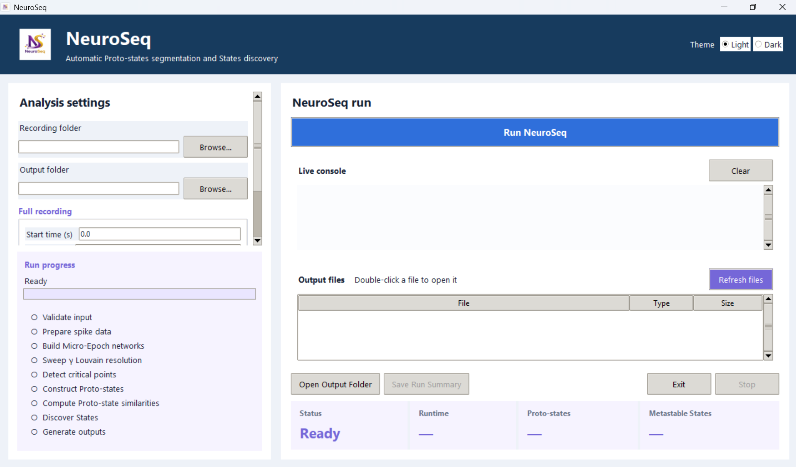
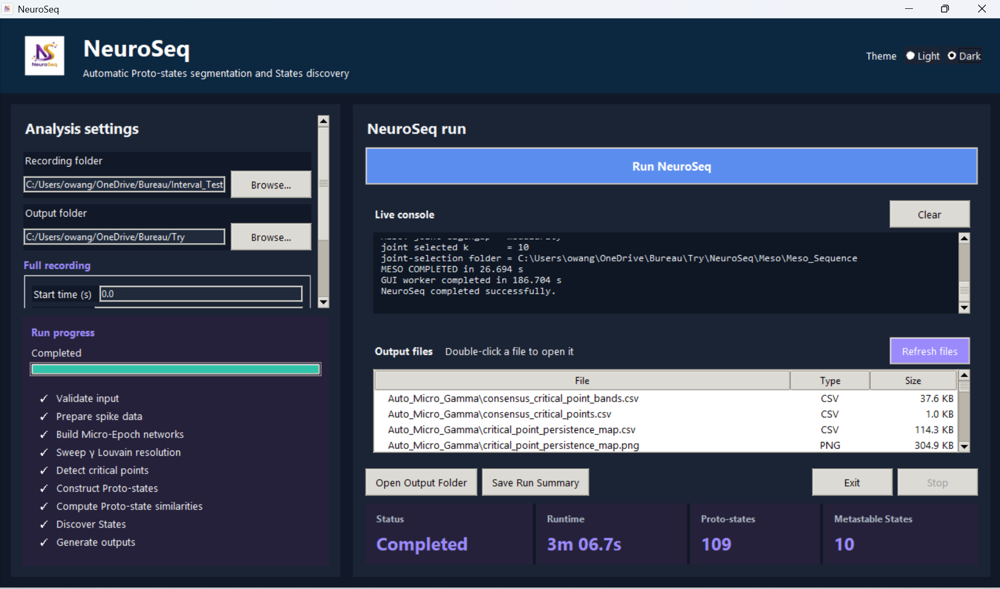
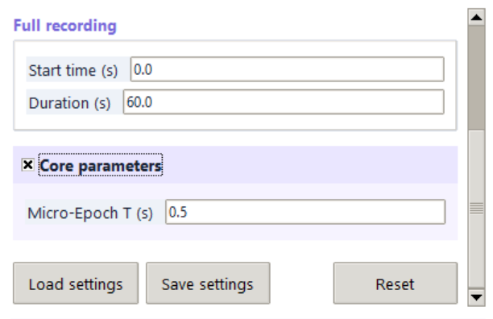
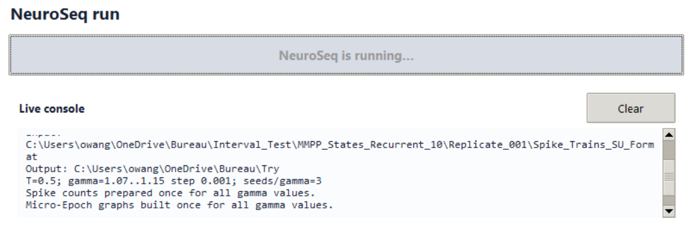

# 2. GUI walkthrough

1. From the repository root, activate `.venv` and launch with `python -m GUI.launcher`.
2. Select **Recording folder** → `Tutorial/Example_Data`. Only files matching `SU_*.csv` are analyzed; `ground_truth_states.csv` is ignored.
3. Select **Output folder** → a new parent folder such as `NeuroSeq_Example_Results`. The orchestrator creates a child folder named `NeuroSeq` automatically.
4. Set **Start time** to `0` seconds and **Total duration** to `60` seconds.
5. Under **Core Parameters**, keep **Micro-Epoch T (s)** at `0.5`. This yields 120 consecutive Micro-Epochs for 60 seconds.
6. Leave the gamma settings in the source code. The default sweep is 1.07–1.15 in increments of 0.001, with 3 Louvain seeds per gamma. These controls are deliberately not displayed in the GUI.
7. Click **Run NeuroSeq** once. Observe the live console: spike counts prepared, networks built, gamma sweep progress, Micro completed, Meso completed, and overall completion. Depending on hardware, the sweep may take several minutes.
8. Inspect the completed-run metrics for **Proto-states**, **Metastable States**, and **Runtime**. These are calculated outputs, not targets supplied in advance.
9. Open `<your output parent>/NeuroSeq/`. Read `run_summary.json`, then explore `Micro/`, `Auto_Micro_Gamma/`, and `Meso/` as described in Chapters 3–5.

**Important:** A progress stage such as “Prepare spike data” describes the display state, not a separate execution. The GUI worker invokes the same `run_pipeline()` as the command-line launcher. Do not launch a second run while one is already in progress.

### Suggested screenshots to capture for GitHub

After a successful run, capture the input/output selections, the `T=0.5` control, the live gamma-sweep console, the completed metrics, and the actual output directory. Place these screenshots in `Tutorial/Images/` and link them here. **No screenshots are included until a real run is captured.**

[Next: Understanding Micro](03_Understanding_Micro.md).

## Illustrated walkthrough of the actual NeuroSeq GUI

The screenshots below were supplied from a **real completed NeuroSeq analysis**. They illustrate the interface and its outputs, but **are not the expected results of the bundled `Tutorial/Example_Data/` recording**. The pictured run reports 109 Proto-states and 10 Metastable States; these counts must not be treated as universal expected values.

### Step A — Open the application

The left panel contains analysis settings and the progress checklist. The right panel contains the Run button, live console, output-file browser, and summary metrics. The theme can be changed without affecting the analysis.

### Step B — Select input and output directories

Use **Recording folder → Browse** to select a directory containing `SU_*.csv` spike-train files. Select a writable **Output folder** separately. NeuroSeq creates a `NeuroSeq/` subdirectory inside the selected output parent. Avoid putting the output directory inside the spike-train input directory.

### Step C — Configure the recording interval and Micro-Epoch length

Specify **Start time (s)** and **Duration (s)** for the interval to analyze. **Micro-Epoch T (s)** is the only exposed core scientific parameter. The gamma sweep and its seeds are configured in the Python code rather than the GUI. For example, a 60-second recording with `T=0.5` is divided into 120 Micro-Epochs.

### Step D — Run the analysis and watch the live console

Click **Run NeuroSeq** once. During execution, the button is disabled, progress stages are updated, and the live console reports spike-count preparation, Micro-Epoch graph construction, gamma-sweep progress, and completion of Micro and Meso. Console lines are progress reports, **not additional executions** of the analysis.

### Step E — Inspect the completed run

The completed-run panel reports status, wall-clock runtime, Proto-state count, and Metastable State count. In this screenshot, **109 Proto-states** and **10 Metastable States** were obtained. These are inferred results, not values selected beforehand. The displayed runtime depends on the computer and input recording.

### Step F — Open the generated results

Use **Output files** to browse and double-click saved results, or **Open Output Folder** to inspect the full output directory. The next chapters explain the Micro and Meso figures shown below.
