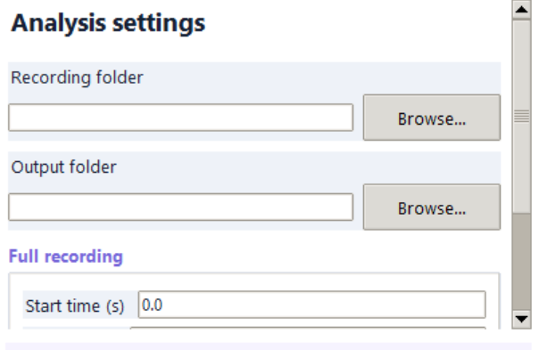
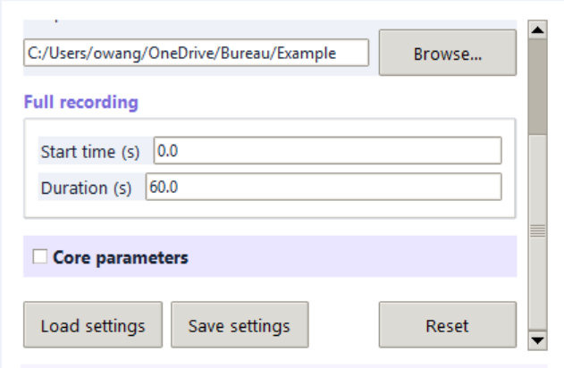
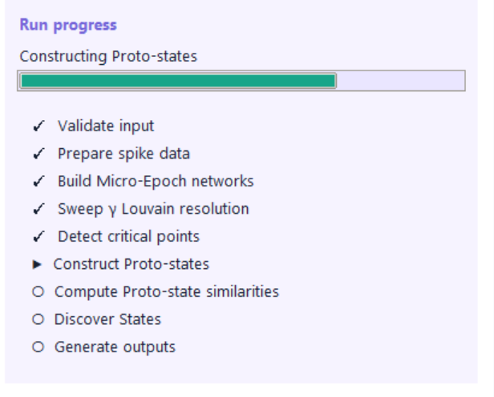
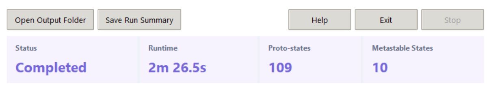
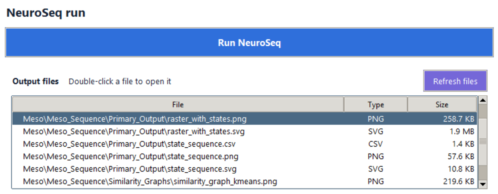
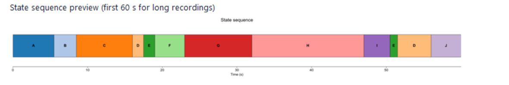
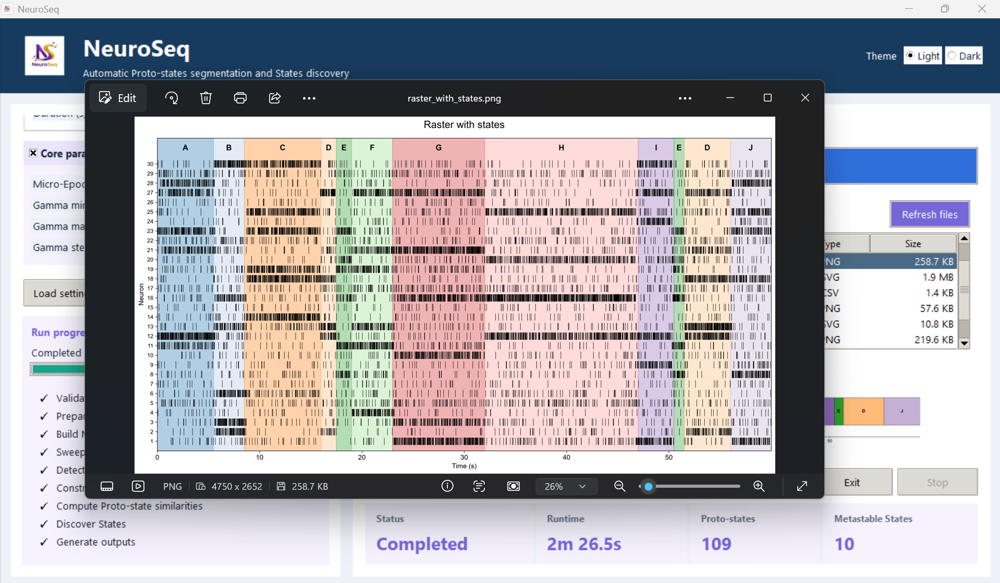

# 2. GUI walkthrough

## Step 1 — Launch and choose a theme

Run `python -m GUI.launcher` from the repository root. Both folder fields begin **blank**. Click **Browse** to choose a directory; the chooser initially opens at the directory from which NeuroSeq was launched. You can choose **Light** or **Dark** without affecting any analysis.

## Step 2 — Choose input and output folders

**Recording folder** must contain `SU_*.csv` spike timestamps. **Output folder** is the *parent* destination, and NeuroSeq creates `<output folder>/NeuroSeq/` for the run. Other files such as `ground_truth_states.csv` are not input spike trains.

## Step 3 — Set the analysis interval

Enter **Start time (s)** and **Duration (s)**. For the bundled example, use `0` and `60`. If you enter a duration extending past the last observed spike, NeuroSeq automatically shortens the interval. For example, an observed endpoint of 60 s and a requested 70 s starting at 0 yields at most 60 s. A request for 40 s uses 40 s. If the start time is beyond the available spike data, the run cannot proceed.

**Caution:** The last spike is not necessarily the recording's acquisition end time. In data with a silent tail, this fallback may shorten the nominal recording.

## Step 4 — Configure core parameters

Expand **Core parameters** to see **Micro-Epoch T (s)**, **Gamma minimum**, **Gamma maximum**, and **Gamma step**. Keep gamma minimum `1.07`, maximum `1.15`, and step `0.001` as default values. A 60-second interval at `T=0.5` has 120 Micro-Epochs. Changing these settings can change the inferred boundaries and labels; they are not merely display options. Other algorithm settings, including random seeds, remain configured in code.

**Load settings** restores saved GUI settings from a JSON file. **Save settings** writes the current settings to a JSON file. **Reset** restores defaults and clears the selected folder fields. Use **Help** for descriptions of controls and the analysis workflow.

## Step 5 — Run and follow progress

Click **Run NeuroSeq** once. The **Run progress** panel shows input validation, spike preparation, Micro-Epoch networks, gamma sweep, critical points, Proto-state construction, Proto-state similarities, Metastable State discovery, and output generation.

## Step 6 — Inspect completion and figures

On success, the bottom cards show **Completed**, runtime, the number of **Proto-states**, and the number of **Metastable States**. These counts are inferred; they are not supplied as parameters. The example screenshot reports **109 Proto-states** and **10 Metastable States** from a separate run, **not necessarily from the bundled synthetic data**.

The **Output files** table intentionally lists only principal results. Double-click a listed file to open it; **Refresh files** reloads the list from disk and does **not** clear or delete existing files. **Open Output Folder** opens all results, including detailed scientific diagnostics. **Save Run Summary** saves the run summary. **Stop** requests cancellation during an active run; **Exit** closes the application.

Below the file list, the **State sequence preview** shows the first 60 seconds of a longer recording (or the available interval for a shorter run). The full sequence is still saved on disk.

The output raster uses **Neuron** as the vertical-axis label, with numeric neuron identifiers, and colors the inferred state intervals.

[Next: Understanding Micro](03_Understanding_Micro.md).
