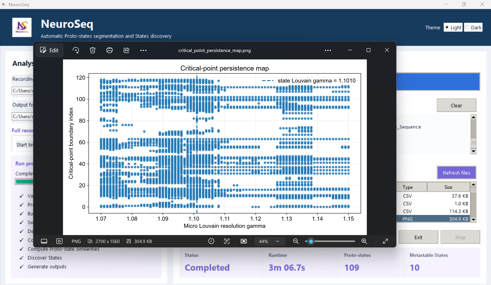
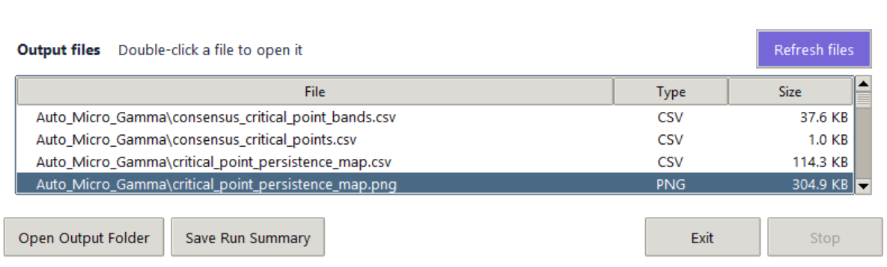

# 3. Understanding Micro

Micro analyzes **when population activity changes**. It does not calculate the final Proto-state firing-rate vectors or pairwise Proto-state affinities; those belong to Meso.

## Step-by-step

1. Spike timestamps are restricted to the requested interval and counted in consecutive windows of length `T`.
2. A functional neuronal network is constructed for each Micro-Epoch from its spike counts.
3. Louvain community partitions are evaluated across the configured gamma sweep, using multiple seeds per gamma.
4. Adjacent Micro-Epoch partitions are compared using normalized mutual information (NMI). Lower adjacent NMI indicates stronger partition dissimilarity, not automatically a confirmed change point.
5. A two-component Gaussian-mixture (`gmm2`) threshold is used in the critical-point workflow. Candidate critical points are evaluated across gamma values and consolidated using the configured persistence and consensus tolerances.
6. A representative gamma is selected from the gamma sweep. The consensus critical points define the temporal boundaries subsequently used by Meso.

The default `T=0.5` s produces 120 windows in a 60-second example. Changing `T` changes temporal resolution and may change the resulting segmentation. The gamma range is 1.07–1.15 with step 0.001 (81 candidate values), and 3 seeds per gamma. These values are configured in `RunConfig` and hidden from the GUI.

## What to inspect

- `Micro/micro_ctx.json`: machine-readable handoff to Meso; contains the selected representative gamma and Micro output paths.
- `Auto_Micro_Gamma/gamma_structure_selection.csv`: gamma-sweep structural diagnostics.
- `Auto_Micro_Gamma/critical_point_persistence_map.csv`: candidate boundary persistence across gamma values.
- `Auto_Micro_Gamma/consensus_critical_point_bands.csv` and `consensus_critical_points.csv`: consolidated candidate boundaries; consult the generated file headers for precise field names.
- `Auto_Micro_Gamma/state_louvain_gamma_selection.csv`: representative gamma selection diagnostics.

These files are generated in nested analysis directories; their exact paths can be recovered from `run_summary.json` and `micro_ctx.json`. Do not assume every low-NMI boundary is a true state transition.

[Next: Understanding Meso](04_Understanding_Meso.md).

## Screenshot example: critical-point persistence

The **horizontal axis** is the Micro Louvain resolution parameter γ; the **vertical axis** indexes candidate critical-point boundaries. Each plotted mark represents a detected candidate at a gamma value. Repeated marks across nearby gamma values illustrate persistence of candidate boundaries. The dashed vertical line identifies the **representative gamma** selected by the algorithm (approximately 1.1010 in this screenshot). The plot does **not** show ground-truth state identities and is not a direct firing-rate plot.

The output browser includes `critical_point_persistence_map.csv` (underlying numerical results), `critical_point_persistence_map.png` (the visualization), and consensus critical-point CSV files. The exact temporal consensus boundaries should be read from the saved CSV outputs rather than estimated visually from this map.

*The screenshots correspond to a user-provided demonstration run, not necessarily the bundled synthetic example.*
