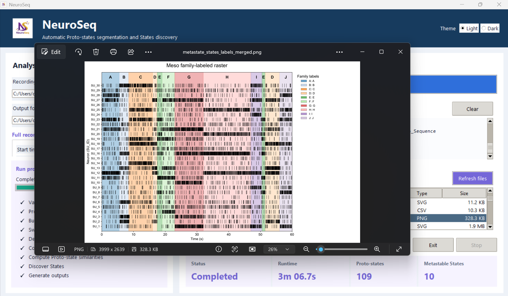
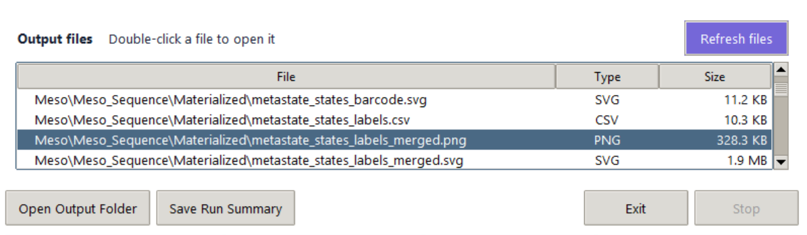

# 4. Understanding Meso

Meso starts **after Micro**, using the consensus critical points and representative gamma recorded in `Micro/micro_ctx.json`.

## From boundaries to Proto-states

Consensus critical points divide the analyzed interval into consecutive Proto-state intervals. Within each interval, Meso computes a Louvain partition of the neurons and a population firing-rate vector. For neuron `i` in Proto-state `p`, its firing-rate component is

\[r_{p,i} = N_{p,i} / (t_p^{end} - t_p^{start})\]

where `N_{p,i}` is the number of spikes in that interval. Rates are in spikes per second (Hz). Each Proto-state vector should therefore contain one component for every recorded neuron.

## From Proto-states to Metastable States

For each pair of Proto-states, Meso compares the neuronal partitions using NMI and the population firing-rate signatures using a distance. The Meso affinity is the **multiplicative exponential Gaussian-kernel S-score**:

\[
S_{ij}=\exp\!\left(-\frac{\widetilde D_{ij}^{\,2}}{2\sigma_D^2}\right)
       \exp\!\left(-\frac{(1-\mathrm{NMI}_{ij})^2}{2\sigma_{\mathrm{NMI}}^2}\right),
\qquad \widetilde D_{ij}=\frac{D_{ij}}{D_{\max}}.
\]

Here, `D_ij` is the population firing-rate-vector distance, `D_max` is the maximum finite pairwise distance, and `NMI_ij` compares neuronal Louvain partitions. Kernel widths `sigma_D` and `sigma_NMI` are computed from the observed pairwise values by `safe_scale` in `Meso/meso_utils.py` (fallback `0.25`). The implementation clips normalized distances to `[0, 1]` and handles nonfinite values. Each pairwise S-score is placed into a **symmetric Proto-state affinity matrix** with diagonal entries fixed at 1. This matrix is used in subsequent spectral candidate selection and Metastable State discovery.

The source (`Meso/meso_score.py`) defines numerical edge-case handling. Meso constructs an affinity matrix and evaluates candidate numbers of clusters using a joint eigengap–modularity criterion. Spectral clustering then assigns Proto-states to Metastable States; the number of Metastable States is **not entered by the user**.

## How to interpret the labels

- **Proto-state**: a contiguous time interval delimited by Micro-derived boundaries.
- **Metastable State**: a cluster of Proto-states with similar neuronal organization and activity signatures; it can recur at separated times.
- **Letter labels**: display identifiers, not a quantitative ranking or proof of biological equivalence.

The synthetic reference regimes in `ground_truth_states.csv` were used to generate the example. They are not passed to Meso, and exact recovery is not guaranteed.

[Next: Interpreting outputs](05_Interpreting_Outputs.md).

## Screenshot example: inferred Metastable States

The **horizontal axis** is time (seconds) and the **vertical axis** lists recorded single units (`SU_1`, `SU_2`, and so on). Black tick marks indicate spike events. Colored vertical bands and the letters above them indicate the Metastable State labels assigned to successive time intervals. The same letter appearing at separated times indicates a recurrence of an **inferred** Metastable State. Letters are categorical identifiers, not rankings or behavioral labels.

In this screenshot, ten distinct letters (A–J) appear. These should not be interpreted as ten ground-truth states without an independent comparison. The displayed spike raster is an output visualization, not the affinity matrix itself.

For this visualization, the GUI output browser shows `metastate_states_labels_merged.png` and `.svg`, alongside `metastate_states_labels.csv` and a barcode SVG. Prefer the saved PNG or SVG file for figures in papers; use the CSV when quantitative time boundaries and labels are required.

*This screenshot is a real demonstration run and is not a claim about the bundled example's expected clustering.*
