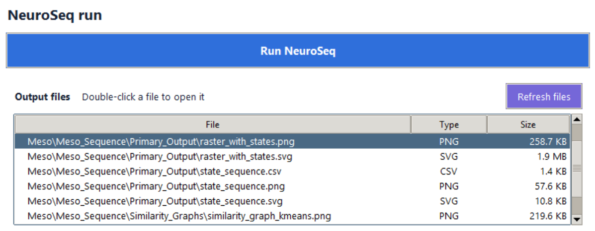
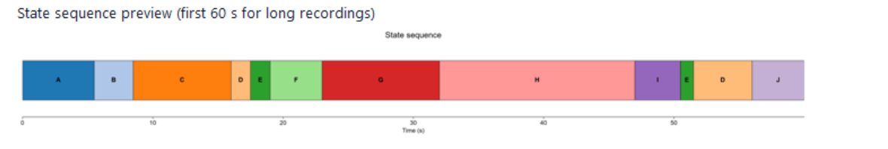
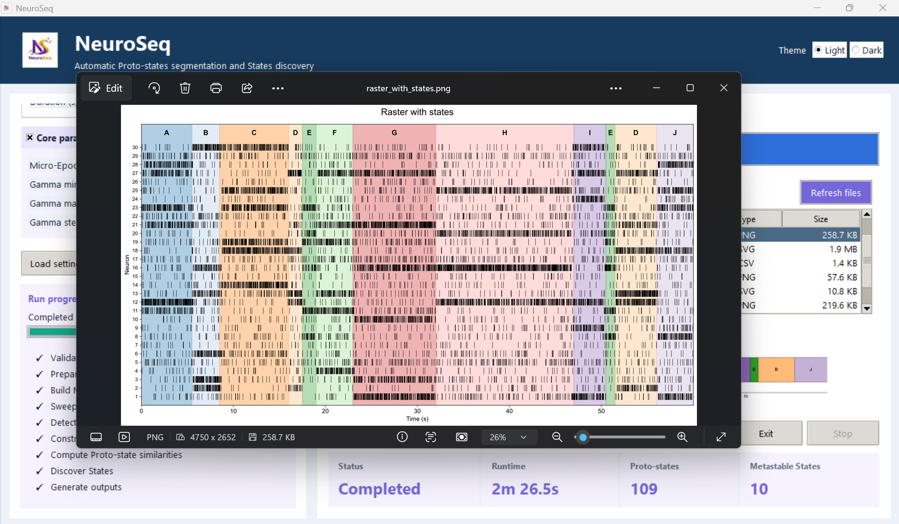

# 5. Interpreting NeuroSeq outputs

## Where NeuroSeq saves results

Choose an **Output folder** in the GUI. NeuroSeq creates a `NeuroSeq/` subdirectory beneath it. The key output areas are:

```text
NeuroSeq/
├── Micro/                         # Micro handoff and diagnostics
├── Auto_Micro_Gamma/              # Gamma selection and critical points
├── Meso/
│   └── Meso_Sequence/
│       ├── Proto-States/          # Proto-state comparison tables (location may vary)
│       ├── Similarity_Graphs/     # Similarity graph exports
│       └── Primary_Output/
│           ├── state_sequence.csv
│           ├── state_sequence.png / .svg
│           ├── raster_with_states.png / .svg
│           └── Raster_60s/
│               ├── raster_with_states_1.png / .svg
│               ├── raster_with_states_2.png / .svg
│               └── ...
├── run_summary.json
└── runtime.csv
```

**Note:** The tree highlights key names and is illustrative; some CSVs and directories may be nested differently by the current workflow. Use `run_summary.json`, `Micro/micro_ctx.json`, and **Open Output Folder** to locate exact paths. The GUI's **Output files** table intentionally shows only main presentation files, not every CSV or diagnostic.

## Main figures

| File | Interpretation |
| --- | --- |
| `state_sequence.png` / `.svg` | Full timeline of inferred Metastable State labels; colors and letters indicate categories. |
| `state_sequence.csv` | State sequence in machine-readable form. |
| `raster_with_states.png` / `.svg` | Full spike raster with colored Metastable State intervals. |
| `Raster_60s/raster_with_states_1.png` / `.svg` | First 60-second raster view (or shorter final available interval). |
| `Raster_60s/raster_with_states_2.png` / `.svg`, etc. | Subsequent consecutive 60-second views, numbered in chronological order. |
| `similarity_graph_kmeans.png` / `.svg` | Visualization of the Proto-state similarity graph with inferred cluster labels. |
| `spike_raster...png` | Spike raster without the overlaid Metastable State bands, when generated. |

**Important:** The 60-second raster views are **visualization only**. Micro and Meso analyze the entire effective interval together. A Metastable State crossing a 60-second boundary retains its label and color; the plots do not create new transitions. The GUI preview shows the **first 60 seconds** of a long state sequence, but the saved full-length figure still covers the complete interval.







## Diagnostic files and numerical results

| File | Interpretation |
| --- | --- |
| `run_summary.json` | Runtime, number of neurons, requested/effective interval metadata where available, gamma and Micro/Meso result references. |
| `runtime.csv` | Compact runtime summary; runtime depends on the machine and environment. |
| `Micro/micro_ctx.json` | Handoff containing Micro boundaries, selected gamma and output references. |
| `proto_state_louvain_gamma_selection.csv` | Representative gamma selection. |
| `critical_point_persistence_map.csv` | Critical-point persistence across gamma. |
| `consensus_critical_points.csv` | Selected Proto-state boundaries. |
| `proto_state_vectors.csv` | Firing-rate vectors for Proto-states (Hz); columns/identifiers use Proto-state terminology. |
| `proto_state_louvain_nmi.csv` | Pairwise NMI between Proto-state Louvain partitions. |
| `proto_state_louvain_nmi_long.csv` | Long-form NMI comparisons. |
| `mean_firing_rate_distance.csv` | Pairwise firing-rate distance. |
| `pairs_nmi_dist.csv` | Pairwise NMI and distance data, if emitted. |
| `pairs_nmi_dist_score.csv` | Pairwise combined exponential S-score, if emitted. |
| `s_score_matrix.csv` | Symmetric pairwise S-score matrix, if emitted. |
| `spectral_similarity_matrix.csv` | Similarity/affinity matrix used in spectral grouping. |
| `spectral_candidate_k_scores.csv` | Candidate-number diagnostics, if emitted. |
| `spectral_state_labels.csv` | Spectral assignments; the Proto-state identifier column is `proto_state_index`. |
| `similarity_graph_edges_for_plot.csv` | Edge data for the similarity-graph visualization. |

The **Proto-state** names in exported CSV files distinguish individual contiguous intervals from **Metastable State** labels, which can recur. In the relevant Proto-state tables, identifiers such as `proto_state_1` replace older `state_1` labels. Do not reinterpret a Proto-state index as a Metastable State identity.

## Interpreting counts and recurrence


The pictured run reports 109 Proto-states and 10 Metastable States. These counts are specific to that separate recording and its settings; **109 is not the neuron count**. Multiple Proto-states may share a Metastable State label because their population signatures are similar under the implemented affinity. Matching labels do not imply identical spikes, identical stimulus responses, or established causal mechanisms.

NeuroSeq does not infer stimulus selectivity, anatomical connectivity, or ground-truth accuracy automatically. Such conclusions require independent metadata and validation.

[Next: Reproducibility](06_Reproducibility.md).
