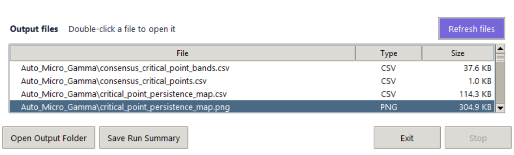
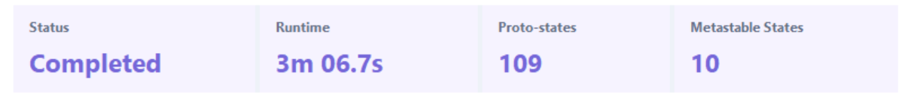

# 5. Interpreting NeuroSeq outputs

## Directory overview

The GUI's output selection is a **parent directory**. NeuroSeq writes into `<output parent>/NeuroSeq/`:

```text
NeuroSeq/
├── Micro/                  # Micro diagnostics and micro_ctx.json
├── Auto_Micro_Gamma/       # Gamma sweep and critical-point diagnostics
├── Meso/                   # Proto-state and Metastable State outputs
├── run_summary.json       # Main run metadata and returned output paths
└── runtime.csv            # Compact runtime and neuron-count summary
```

Nested paths depend on the workflow; use `run_summary.json` and `Micro/micro_ctx.json` to locate the actual generated files. The names below are taken from the current source code, but not all products are guaranteed for every run or option.

## Run summaries

| File | Interpretation |
| --- | --- |
| `run_summary.json` | Runtime in seconds, analyzed neuron count, `T`, interval start and duration, representative gamma, and returned Micro/Meso output dictionaries. |
| `runtime.csv` | One-row summary with method, runtime seconds, neuron count, and analyzed duration. Runtime is machine- and environment-dependent. |
| `Micro/micro_ctx.json` | Authoritative handoff from Micro to Meso. Check representative gamma and saved output paths. |

## Micro diagnostic outputs

| File (basename) | Interpretation |
| --- | --- |
| `gamma_structure_selection.csv` | Structural/gamma-sweep diagnostics used to evaluate candidate resolutions. |
| `critical_point_persistence_map.csv` | How candidate temporal boundaries persist across gamma values. |
| `consensus_critical_point_bands.csv` | Candidate boundaries consolidated into consensus bands. |
| `consensus_critical_points.csv` | Final selected critical-point times used to delimit Proto-states. |
| `state_louvain_gamma_selection.csv` | Representative gamma selection diagnostics. |

**Reading advice:** Examine the actual CSV column headers and accompanying diagnostic plots. A high number of critical points can produce many short Proto-states; it does not automatically imply many distinct Metastable States.

## Meso outputs

| File (basename) | Interpretation |
| --- | --- |
| `state_vectors.csv` | Population firing-rate signature for each Proto-state; neuron components are in spikes/s. Compare rows to see changes in activity patterns. |
| `state_louvain_nmi.csv` | Pairwise NMI similarities between Proto-state neuronal partitions. |
| `mean_firing_rate_distance.csv` | Pairwise distance matrix between Proto-state firing-rate vectors. |
| `pairs_nmi_dist.csv` | Pairwise comparison table containing partition similarity and firing-rate distance. |
| `pairs_nmi_dist_score.csv` | Pairwise table with the combined similarity score. |
| `s_score_matrix.csv` | Pairwise similarity-score matrix. |
| `spectral_affinity_matrix.csv` | Affinity matrix used for spectral grouping. |
| `spectral_candidate_k_scores.csv` | Candidate cluster-count diagnostics; inspect the joint-selection outputs to understand the selected `k`. |
| `spectral_state_labels.csv` | Assignment of Proto-states to spectral clusters. |
| `metastate_states_labels.csv` | Metastable State labels and related interval information. |
| `metastate_states_barcode.csv` | Timeline/barcode representation of the final labels. |
| `metastate_states_barcode.png` | Visualization of the state sequence; colors indicate labels, not confidence. |
| `similarity_graph.png` / `.svg` | Graph representation of Proto-state similarity (when graph outputs are enabled). |

### Worked interpretation

Suppose two Proto-state intervals occur at different times but receive the same Metastable State label. This means the spectral grouping judged their neuronal partitions and firing-rate signatures sufficiently similar under the implemented affinity. It **does not** mean the intervals have identical spike trains, and it does not by itself prove that they correspond to the same stimulus or behavior.

Likewise, if `state_vectors.csv` contains many Proto-states while the final label table contains fewer unique Metastable State labels, that is expected: Meso groups multiple Proto-states into a smaller number of recurring state categories.

## What NeuroSeq does *not* infer automatically

NeuroSeq does not establish stimulus selectivity, anatomical connectivity, causal mechanisms, or ground-truth accuracy from the output files alone. Such claims require independent experimental metadata or validation analyses. The tutorial example's known generator sequence can be used for a separate comparison, but is not an input to state discovery.

[Next: Reproducibility](06_Reproducibility.md).


## Visual guide to locating and interpreting outputs

### Micro: persistence and consensus



Open `critical_point_persistence_map.png` for a visual survey of candidate critical points across gamma. Consult `critical_point_persistence_map.csv` for the data behind the plot. The `consensus_critical_points.csv` and `consensus_critical_point_bands.csv` files are more appropriate for inspecting the final selected boundaries.

### Meso: timeline and spike raster


Open `metastate_states_labels_merged.png` for the state-labeled spike raster. The `.svg` counterpart is suitable for scalable vector graphics. Use the accompanying label CSV files for downstream numerical analysis rather than extracting boundaries from the image.

### Summary: interpretation of counts



The screenshot shows a particular run with 109 Proto-states and 10 Metastable States. A Proto-state is a time interval constructed from consensus boundaries; a Metastable State groups related Proto-states. **109 is not the number of neurons**, and neither count is fixed by the GUI. Results will vary with the recording and analysis parameters.

### Screenshots versus reproducible example

The screenshots supplied for this guide are from an actual GUI run. They are illustrative and **must not be mistaken for the expected output of `Tutorial/Example_Data/`**. To create an exact reproducibility reference, run that example separately and archive its `run_summary.json`, consensus-boundary CSVs, and final label CSVs.
